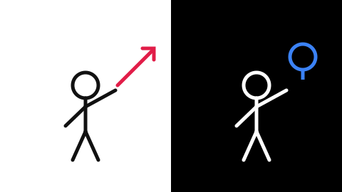
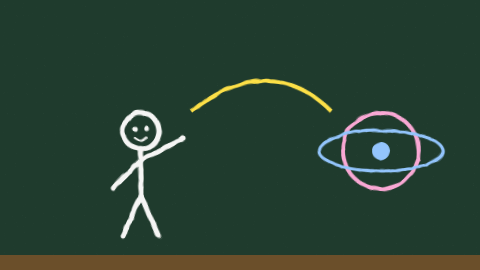
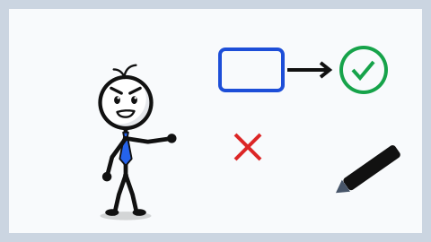
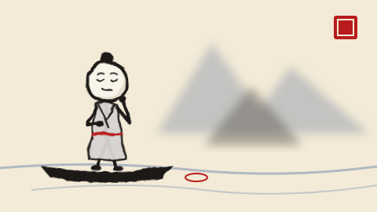
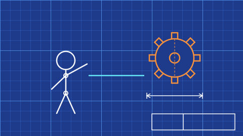
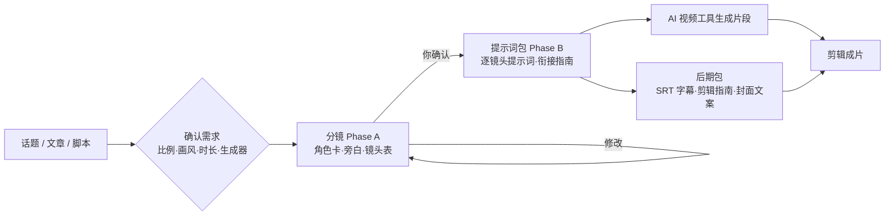

# 🎬 Stickman_Video

> 把话题、文章或脚本变成火柴人视频：先出分镜让你确认，再给出每个镜头可直接粘贴到 AI 视频工具的提示词，附带字幕和剪辑指南。
>
> Turn any topic, article or script into a stick-figure video: an approved storyboard first, then copy-ready per-shot prompts for AI video generators, plus SRT subtitles and an edit guide.


## ✨ 特性

- **导演式两步流程**：分镜（Phase A）确认后才输出提示词（Phase B），避免浪费生成额度。
- **10 种画风**：极简水笔、彩色扁平、黑板粉笔、白板手绘、霓虹暗夜、纸片剪贴、水墨国风、粘土定格、工程蓝图、水彩绘本。
- **角色/旁白一致性**：角色锚点与旁白声音块在每个镜头中逐字重复。
- **多生成器适配**：Veo、Sora、可灵、海螺、即梦、Runway，以及“先图后视频”路线。
- **字幕脚本**：`make_srt.py` 把确认后的旁白生成 SRT。

## 🖼 画风预览

<table width="100%">
<tr><td width="50%" align="center"><strong>S1 · 极简水笔（明/暗）</strong><br></td><td width="50%" align="center"><strong>S2 · 彩色扁平</strong><br></td></tr>
<tr><td width="50%" align="center"><strong>S3 · 黑板粉笔</strong><br></td><td width="50%" align="center"><strong>S4 · 白板手绘</strong><br></td></tr>
<tr><td width="50%" align="center"><strong>S5 · 霓虹暗夜</strong><br></td><td width="50%" align="center"><strong>S6 · 纸片剪贴</strong><br></td></tr>
<tr><td width="50%" align="center"><strong>S7 · 水墨国风</strong><br></td><td width="50%" align="center"><strong>S8 · 粘土定格</strong><br></td></tr>
<tr><td width="50%" align="center"><strong>S9 · 工程蓝图</strong><br></td><td width="50%" align="center"><strong>S10 · 水彩绘本</strong><br></td></tr>
</table>

> 以上为各画风的动态示意图（SVG），用来说明构图和配色方向；实际成片由你选择的 AI 视频工具按提示词生成。重新生成预览：`python3 scripts/gen_previews.py`。

## 🔄 工作流程



## 🎨 画风一览

| ID | 画风 | 适合内容 |
|----|------|----------|
| S1 | 极简水笔（明/暗） | 科普、心理学、商业知识 |
| S2 | 彩色扁平 | 效率、产品讲解、生活技巧 |
| S3 | 黑板粉笔 | 原理、数理、历史时间线 |
| S4 | 白板手绘 | 流程、方法论、销售讲解 |
| S5 | 霓虹暗夜 | 科技、AI、悬疑 |
| S6 | 纸片剪贴 | 温暖故事、儿童内容 |
| S7 | 水墨国风 | 历史、成语、哲理、东方传说 |
| S8 | 粘土定格 | 生活小剧场、产品演示、儿童科普 |
| S9 | 工程蓝图 | 工作原理、系统机制、商业模式拆解 |
| S10 | 水彩绘本 | 治愈故事、情感关系、睡前故事 |

详细规范见 [`style-catalog.md`](skills/stickman-video/references/style-catalog.md)。

## 📦 安装

**Claude Code（插件市场）**

```
/plugin marketplace add wbin888/stickman-video
/plugin install stickman-video@stickman-video
```

**手动安装（Claude Code / Codex / 其他支持 Skills 的 Agent）**

```bash
git clone https://github.com/wbin888/stickman-video
# Claude Code
cp -r stickman-video/skills/stickman-video ~/.claude/skills/
# Codex
cp -r stickman-video/skills/stickman-video ~/.codex/skills/
```

也可以直接对 AI 助手说：

```
帮我安装这个 Skill：https://github.com/wbin888/stickman-video
```

## 🚀 使用

```
用 Stickman_Video 帮我做一个 60 秒的竖屏视频，画风 S7 水墨国风，
主题是“刻舟求剑”，生成器用即梦。
```

流程：

1. **确认需求**：比例、画风缺失时会一次性问你。时长默认 60 秒，生成器默认 generic（8 秒/镜）。
2. **分镜**：标题、角色卡、旁白声音、镜头表、完整旁白，等待你确认。
3. **提示词包**：每个镜头一段独立提示词 + 衔接指南 + 音频说明。
4. **后期包（可选）**：SRT 字幕、剪辑指南、标题/封面文案。

生成字幕：

```bash
python3 skills/stickman-video/scripts/make_srt.py \
  skills/stickman-video/examples/narration-sample.txt -o subtitles.srt
```

旁白文件每行一个镜头，可写成 `秒数|旁白` 指定该镜头时长。

## 🗂 目录结构

```
assets/previews/                 # README 画风预览图
scripts/gen_previews.py          # 生成预览图
skills/stickman-video/
├── SKILL.md                     # 技能入口
├── agents/openai.yaml           # Codex 展示信息
├── references/
│   ├── style-catalog.md         # 10 种画风
│   ├── storyboard-template.md   # 分镜模板
│   ├── prompt-contract.md       # 镜头提示词规范
│   ├── generator-profiles.md    # 各生成器参数
│   └── voice-profile.md         # 旁白一致性
├── scripts/make_srt.py          # 字幕生成
└── examples/narration-sample.txt
```

## 🧪 测试

```bash
python3 tests/test_skill.py
```

## 🙏 致谢

灵感来自 [kaomei/stickman-video-director](https://github.com/kaomei/stickman-video-director)（MIT）。本项目为独立重写的精简版。

## 📄 License

[MIT](LICENSE)
